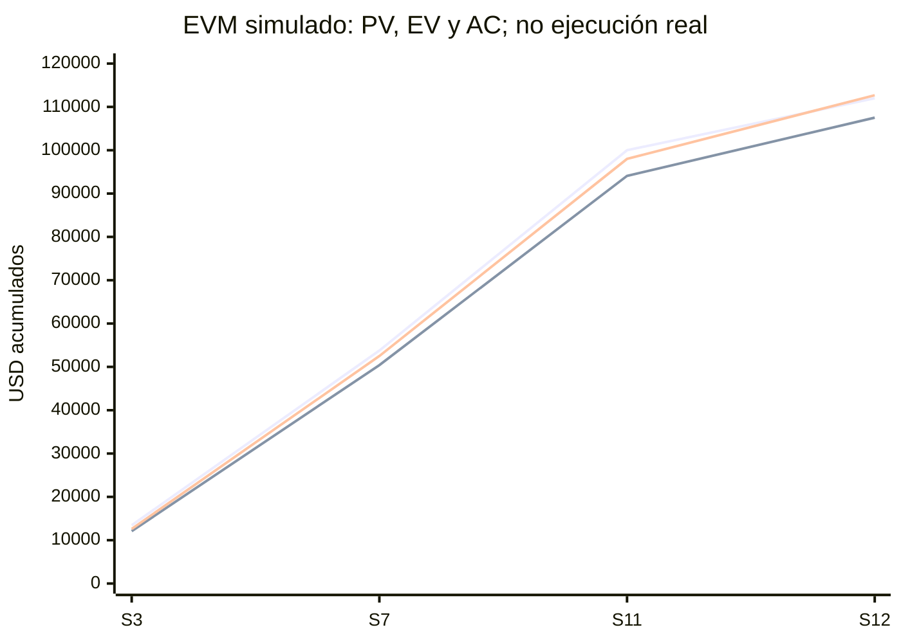
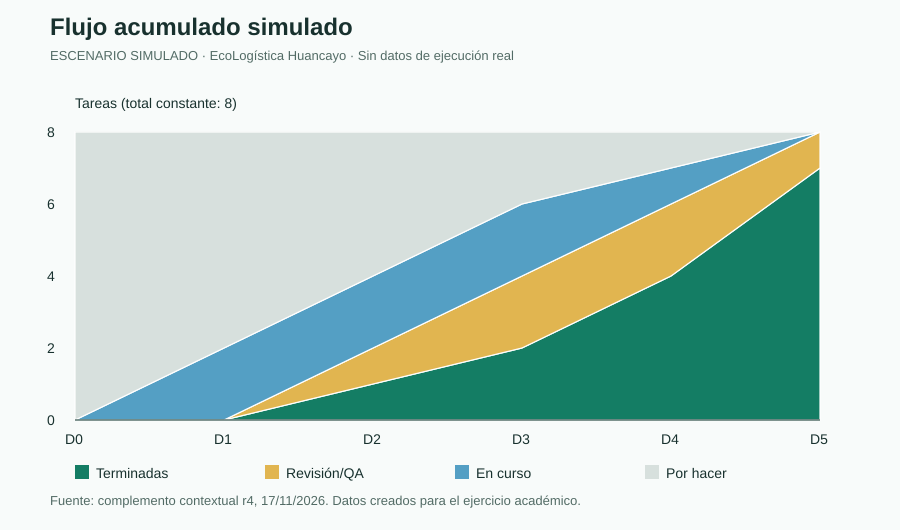
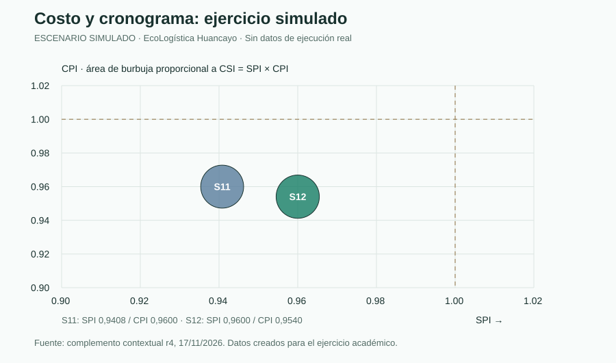
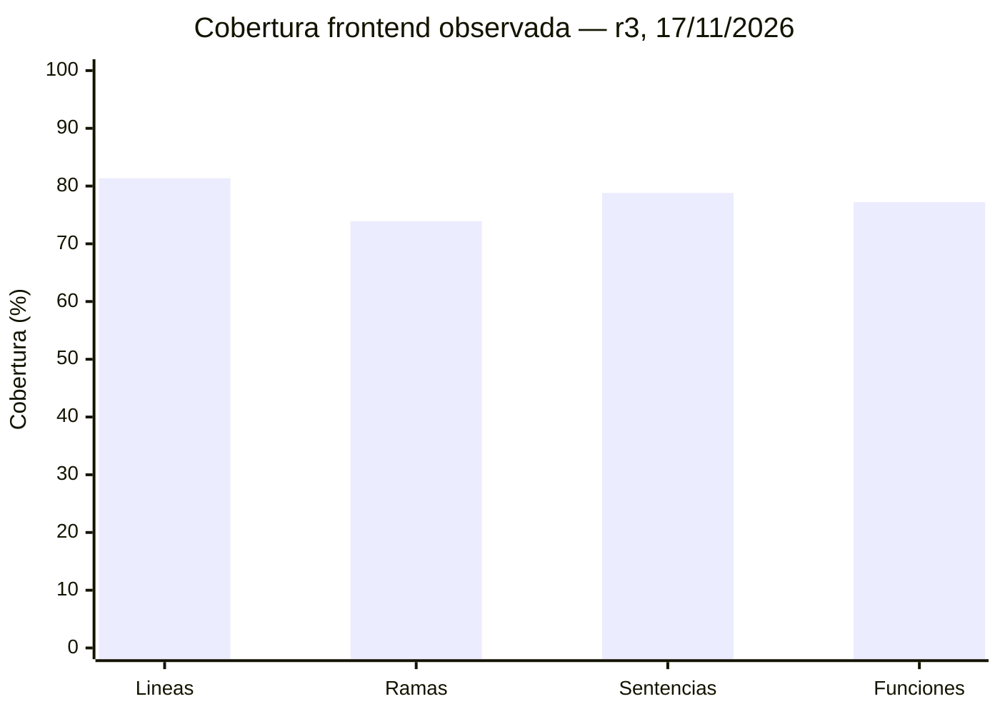

[Volver al README principal](../../README.md)

> **Actualización documental r3 — 17/11/2026.** El [estado técnico vigente](../ESTADO_TECNICO_VIGENTE.md) contiene la medición frontend nueva y sus límites. El texto r2 que sigue se conserva como registro histórico; sus pruebas backend, SW, análisis de seguridad y aceptaciones no se reejecutaron en r3. No constituye cierre aprobado.

# Tableros de Control Híbridos (Hybrid Dashboards)

<!-- complemento-r4:inicio -->
> **Complementación documental r4 — 17/11/2026.** El apartado siguiente aporta propuestas y datos simulados para completar vacíos. No declara nuevas pruebas, gastos ni aprobaciones reales. [Escenario común](../COMPLEMENTO_CONTEXTUAL_DEL_PROYECTO.md).

## Complementación r4: tableros ilustrativos con datos del escenario

**Datos simulados, sin exportación Jira ni libro de costos real.** Responsables propuestos: PM actualiza gestión cada viernes; QA actualiza calidad al terminar validación. Para el ejemplo se propone ámbar si SPI/CPI está entre 0,95 y 1; rojo si es menor que 0,95; verde desde 1, acompañado del alcance del indicador.

### Tendencia EVM simulada

Series en orden PV/EV/AC. Respaldo accesible: S3 13 440/12 096/12 600; S7 53 760/50 400/52 500; S11 100 000/94 080/98 000; S12 112 000/107 520/112 700 USD. EV queda bajo PV y AC supera EV en los cuatro cortes.

### Datos para flujo acumulado simulado

| Día | Terminadas | +Revisión/QA | +En curso | Total con Por hacer |
|---|---:|---:|---:|---:|
| D0 | 0 | 0 | 0 | 8 |
| D1 | 0 | 0 | 2 | 8 |
| D2 | 1 | 2 | 4 | 8 |
| D3 | 2 | 4 | 6 | 8 |
| D4 | 4 | 6 | 7 | 8 |
| D5 | 7 | 8 | 8 | 8 |

Son límites acumulados de cuatro bandas, no conteos que deban sumarse. El complemento contiene los conteos exclusivos; el total se mantiene en ocho tareas. Dos tareas en QA en D3–D4 motivarían reducir entrada y revisar primero.

### Relación costo–cronograma del ejercicio

| Corte simulado | SPI, eje X | CPI, eje Y | CSI propuesto = SPI×CPI, área relativa |
|---|---:|---:|---:|
| S11 | 0,9408 | 0,9600 | 0,9032 |
| S12 | 0,9600 | 0,9540 | 0,9159 |

Se define CSI explícitamente para este ejemplo, sin atribuir la convención al evaluador. Una burbuja mayor representa producto de índices mayor, no gasto ni tareas. El corte S12 queda ámbar en ambos índices con el umbral propuesto; el cierre real conserva su revisión pendiente.
<!-- complemento-r4:fin -->

---

> **Revisión técnica r2 — 17/11/2026, America/Lima.** Se conserva versión base 1.0.0 y nombre exigido por la plantilla. Referencia vigente: main / b47d5eb7cda26444c56460ea74591cc5f973e0b3 + correcciones sin commit. [Control de implementación](../../AUDITORIA/CONTROL_CORRECCIONES_SPRINT4.md) y [resultados actuales](../../AUDITORIA/REAUDITORIA_POST_CORRECCIONES.md). El estado es borrador, sin aceptación administrativa. Los resultados previos se conservan en sus fuentes y en el historial al final.

**Proyecto:** EcoLogística Junín / Huancayo. **Frecuencia de Actualización:** propuesta al terminar cada validación y revisión de sprint; responsable por confirmar. **Versión:** 1.0.0.

**Borrador; cierre pendiente de aprobación.** Plantilla 5.4; corte vigente r2 sobre b47d5eb + correcciones. [Resultados actuales](../../AUDITORIA/REAUDITORIA_POST_CORRECCIONES.md), [matriz vigente](../../AUDITORIA/MATRIZ_PRUEBAS_ACTUALIZADA.md). El dashboard logístico no equivale a gestión financiera del proyecto. Corte anterior: HEAD 61f0e1e9b0d71c1a0ea3c971fb77e93d0ea977b1 + B-08 sin commit, preservado en sus fuentes.

## 1. Justificación de Métricas (Principio Less is More)

- **Necesidades de los interesados:** PM/evaluador necesitan saber qué puede aceptarse y qué bloquea la entrega; QA necesita fallos/restricciones y cobertura; equipo necesita dependencias y acciones. Necesidades derivadas de roles documentados, no de entrevistas nuevas.
- **Criterios de selección de KPIs:** pocos datos accionables con fuente/corte/denominador: casos aprobados/fallidos, cobertura por capa, existencia de bloqueantes, aceptación y calculabilidad EVM. No mezclar porcentajes técnicos y financieros ni usar verde por existir un archivo.

## 2. Tabla Semáforo (RAG Chart) por Componente

Regla de este corte: verde solo evidencia suficiente para el componente estrecho descrito; ámbar evidencia parcial con límites; rojo fallo/bloqueante o dato indispensable ausente. Es evaluación de control, no aceptación del cliente ni calificación docente.

| Componente / Entregable | Enfoque (Predictivo/Adaptativo) | Estado (🟢 Verde / 🟡 Ámbar / 🔴 Rojo) | Observación / Umbral |
|---|---|---|---|
| Suite backend de este árbol | Adaptativo | Verde |210/210 aprobadas con PostGIS descartable; combinado 80,22 %; solo ese conjunto, no aceptación global. |
| Publicación B-08 | Adaptativo | Ámbar |14/14 casos PostGIS pasan; revisión del responsable pendiente, no cierre de RF-03/07 completos. |
| Calidad frontend | Adaptativo | Verde |70/70 aprobadas; 80,47 % líneas. AF-24 corregido y regresión de cursor añadida. |
| Seguridad/integridad del incremento integral | Adaptativo/transversal | Ámbar |AF-01/02/03 probados; sesiones y SCA mejorados. Infraestructura, privacidad de comprobantes/GPS, alcance y aceptación residual pendientes. |
| Presupuesto/cronograma/EVM | Predictivo | Rojo |Sin BAC aprobado/PV temporal/EV valorado/AC sustentado; no hay proyección económica defendible. |
| Cierre y satisfacción | Híbrido | Rojo |Sin acta/encuesta/transferencia aceptada; documentos como borradores. |

## 3. Gráficos de Desempeño Predictivo y Ágil

### 3.1 Tendencias de Variación y Valor Ganado (Líneas)

**Imagen/gráfico EVM:** no disponible en los registros revisados. Faltan series PV/EV/AC por corte/base monetaria, aprobación BAC y periodos comparables. **Interpretación:** no se puede construir tendencia ni curva acumulada real con un presupuesto estimado o porcentajes de auditoría. [EVM y fuentes faltantes](03%20Reporte%20de%20An%C3%A1lisis%20de%20Valor%20Ganado%20-%20EVM%20V_1_0_0.md).

### 3.2 Flujo Acumulado / Áreas Apiladas

**Imagen/gráfico de Flujo Acumulado:** no disponible; falta historial de transiciones o snapshots diarios auténticos. Una captura estática del tablero de 2024 no permite reconstruir CFD de 2026. **Interpretación:** no se cuantifica cuello de botella ni WIP temporal sin esa serie; obtener exportación vigente antes de graficar.

### 3.3 Relación Costo-Cronograma (SPI vs. CPI con tamaño CSI)

**Imagen/gráfico de Burbujas:** no disponible por falta de índices calculables. **Interpretación:** definir también CSI/escala con el evaluador antes de producirlo; no asumir una convención omitida por la plantilla ni inventar burbujas de desempeño.

### 3.4 Medidores de Estado (Gauges) / Gráficos de Barras

Diagrama conservado de **casos automáticos del corte histórico r2**, no de la ejecución r3 ni de avance funcional o costo:

```mermaid
xychart-beta
    title "Casos aprobados y fallidos — corte histórico r2"
    x-axis [Backend, Frontend, SW]
    y-axis "Casos" 0 --> 250
    bar [210, 70, 4]
    bar [0, 0, 0]
```

Primera serie aprobados; segunda fallidos. Respaldo accesible: backend 210/0, frontend 70/0, SW 4/0; cero omitidas en estas suites. Los 14 B-08 ya están en backend. **Interpretación:** suites verdes en el corte r2, sin acreditar satisfacción, RF completos o EV. [JUnit/JSON y límites actuales](../../AUDITORIA/REAUDITORIA_POST_CORRECCIONES.md).

Cobertura actual: backend 84,37 % líneas / 63,83 % ramas / 80,22 % combinado; frontend 80,47 % líneas / 71,55 % ramas. No es satisfacción, RF aceptados o EV. Siguen pendientes tres gráficos/series y radiadores auténticos: no se fabrican para completar la rúbrica.

## Radiador técnico r3: cobertura con brechas visibles

Fuente: [Vitest/V8 ejecutado en este corte](../evidencias/2026-11-17/frontend.json). Las 86 pruebas pasaron; la cobertura no es completa.

Tabla accesible del gráfico: líneas 81,35 %, ramas 73,93 %, sentencias 78,81 %, funciones 77,22 %. Solo el gate de líneas (80 %) se evalúa como aprobado; no hay conformidad integral acreditada. Los gráficos anteriores corresponden a r2 y no suman sus suites con esta ejecución. [Comparación y límites](../REVISION_DATOS_Y_MEJORAS.md).

## Historial de revisiones del borrador

Revisión r3 (17/11/2026): incorporación de evidencia frontend nueva, cifras con denominador y límites, sin modificar costos reales ni aceptación. El registro r2 conserva sus valores históricos.

| Versión base / revisión | Fecha | Cambio y fuente |
|---|---|---|
|1.0.0 / r0 |17/11/2026, corte previo |Contenido previo conservado en Git b47d5eb y snapshot de bytes/hash [docs_cierre_antes_r1.json](../../AUDITORIA/CORRECCIONES_EVIDENCIAS/docs_cierre_antes_r1.json); auditorías originales sin editar. |
|1.0.0 / r1 técnica |17/11/2026, post auditoría |Actualización autorizada con evidencia nueva, corrección de referencias corruptas y límites explícitos. No cambia baseline aprobada ni constituye aceptación/cierre. |
|1.0.0 / r2 técnica |17/11/2026, validación final |210 backend/70 frontend/4 SW; cobertura final y escape literal en PDF. Evidencia r1 preservada en CORRECCIONES_EVIDENCIAS/docs_cierre_antes_r2.json. Sin aceptación administrativa. |

Audiovisual: **EXCLUIDO TEMPORALMENTE — NO EVALUADO**. El ensayo técnico en vivo de diez minutos continúa pendiente de observación real.
