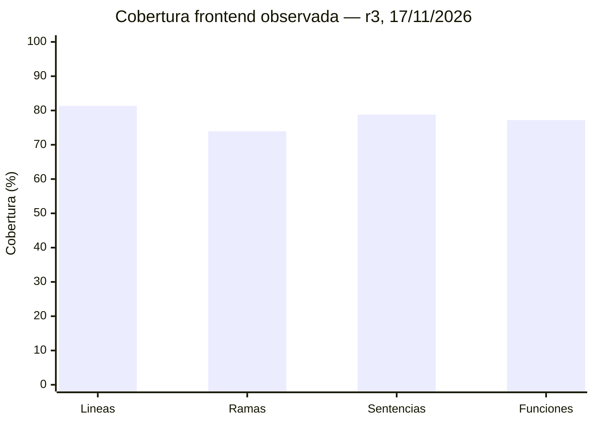

[Volver al README principal](../../README.md)

# Tableros de Control Híbridos (Hybrid Dashboards)

## Complementación r4: tableros ilustrativos con datos del escenario

**Proyecto:** EcoLogística Junín / Huancayo. **Frecuencia de Actualización:** propuesta al terminar cada validación y revisión de sprint; responsable por confirmar. **Versión:** 1.0.0.

## 1. Justificación de Métricas (Principio Less is More)

- **Necesidades de los interesados:** PM/evaluador necesitan saber qué puede aceptarse y qué bloquea la entrega; QA necesita fallos/restricciones y cobertura; equipo necesita dependencias y acciones. Necesidades derivadas de roles documentados, no de entrevistas nuevas.
- **Criterios de selección de KPIs:** pocos datos accionables con fuente/corte/denominador: casos aprobados/fallidos, cobertura por capa, existencia de bloqueantes, aceptación y calculabilidad EVM. No mezclar porcentajes técnicos y financieros ni usar verde por existir un archivo.

## 2. Tabla Semáforo (RAG Chart) por Componente

Regla de este corte: verde solo evidencia suficiente para el componente estrecho descrito; ámbar evidencia parcial con límites; rojo fallo/bloqueante o dato indispensable ausente. Es evaluación de control, no aceptación del cliente ni calificación docente.

| Componente / Entregable | Enfoque (Predictivo/Adaptativo) | Estado (🟢 Verde / 🟡 Ámbar / 🔴 Rojo) | Observación / Umbral |
|---|---|---|---|
| Suite backend de este árbol | Adaptativo | Verde |210/210 aprobadas con PostGIS descartable; combinado 80,22 %; solo ese conjunto, no aceptación global. |
| Publicación B-08 | Adaptativo | Ámbar |14/14 casos PostGIS pasan; revisión del responsable pendiente, no cierre de RF-03/07 completos. |
| Calidad frontend | Adaptativo | Verde |70/70 aprobadas; 80,47 % líneas. AF-24 corregido y regresión de cursor añadida. |
| Seguridad/integridad del incremento integral | Adaptativo/transversal | Ámbar |AF-01/02/03 probados; sesiones y SCA mejorados. Infraestructura, privacidad de comprobantes/GPS, alcance y aceptación residual pendientes. |
| Presupuesto/cronograma/EVM | Predictivo | Rojo |Sin BAC aprobado/PV temporal/EV valorado/AC sustentado; no hay proyección económica defendible. |
| Cierre y satisfacción | Híbrido | Rojo |Sin acta/encuesta/transferencia aceptada; documentos como borradores. |

## 3. Gráficos de Desempeño Predictivo y Ágil

### 3.1 Tendencias de Variación y Valor Ganado (Líneas)

**Imagen/gráfico EVM:** no disponible en los registros revisados. Faltan series PV/EV/AC por corte/base monetaria, aprobación BAC y periodos comparables. **Interpretación:** no se puede construir tendencia ni curva acumulada real con un presupuesto estimado o porcentajes de auditoría. [EVM y fuentes faltantes](03%20Reporte%20de%20An%C3%A1lisis%20de%20Valor%20Ganado%20-%20EVM%20V_1_0_0.md).

### 3.2 Flujo Acumulado / Áreas Apiladas

**Imagen/gráfico de Flujo Acumulado:** no disponible; falta historial de transiciones o snapshots diarios auténticos. Una captura estática del tablero de 2024 no permite reconstruir CFD de 2026. **Interpretación:** no se cuantifica cuello de botella ni WIP temporal sin esa serie; obtener exportación vigente antes de graficar.

### 3.3 Relación Costo-Cronograma (SPI vs. CPI con tamaño CSI)

**Imagen/gráfico de Burbujas:** no disponible por falta de índices calculables. **Interpretación:** definir también CSI/escala con el evaluador antes de producirlo; no asumir una convención omitida por la plantilla ni inventar burbujas de desempeño.

### 3.4 Medidores de Estado (Gauges) / Gráficos de Barras

Diagrama conservado de **casos automáticos del corte histórico r2**, no de la ejecución r3 ni de avance funcional o costo:

```mermaid
xychart-beta
    title "Casos aprobados y fallidos — corte histórico r2"
    x-axis [Backend, Frontend, SW]
    y-axis "Casos" 0 --> 250
    bar [210, 70, 4]
    bar [0, 0, 0]
```

Primera serie aprobados; segunda fallidos. Respaldo accesible: backend 210/0, frontend 70/0, SW 4/0; cero omitidas en estas suites. Los 14 B-08 ya están en backend. **Interpretación:** suites verdes en el corte r2, sin acreditar satisfacción, RF completos o EV. [JUnit/JSON y límites actuales](../../AUDITORIA/REAUDITORIA_POST_CORRECCIONES.md).

Cobertura actual: backend 84,37 % líneas / 63,83 % ramas / 80,22 % combinado; frontend 80,47 % líneas / 71,55 % ramas. No es satisfacción, RF aceptados o EV. Siguen pendientes tres gráficos/series y radiadores auténticos: no se fabrican para completar la rúbrica.

## Radiador técnico r3: cobertura con brechas visibles

Fuente: [Vitest/V8 ejecutado en este corte](../evidencias/2026-11-17/frontend.json). Las 86 pruebas pasaron; la cobertura no es completa.

Tabla accesible del gráfico: líneas 81,35 %, ramas 73,93 %, sentencias 78,81 %, funciones 77,22 %. Solo el gate de líneas (80 %) se evalúa como aprobado; no hay conformidad integral acreditada. Los gráficos anteriores corresponden a r2 y no suman sus suites con esta ejecución. [Comparación y límites](../REVISION_DATOS_Y_MEJORAS.md).

