[Volver al README principal](../../README.md)

# Tableros de Control Híbridos (Hybrid Dashboards)

**Proyecto:** EcoLogística Junín / Huancayo. **Frecuencia de Actualización:** propuesta al terminar cada validación y revisión de sprint; responsable por confirmar. **Versión:** 1.0.0.

**Borrador; cierre pendiente de aprobación.** Plantilla 5.4; corte 17/11/2026, America/Lima, HEAD 61 f0 e1 e+B-08 sin commit. [Resultados actuales](../../AUDITORIA/SPRINT4_RESULTADOS_PRUEBAS.md), [matriz de aceptación](../../AUDITORIA/SPRINT4_MATRIZ_ACEPTACION.md), [presupuesto estimado 15/09/2026](../02%20Planificacion/04_presupuesto_del_proyecto_v_1_0_0.md). Un dashboard logístico de km/CO₂ del producto no equivale a gestión económica del proyecto.

## 1. Justificación de Métricas (Principio Less is More)

- **Necesidades de los interesados:** PM/evaluador necesitan saber qué puede aceptarse y qué bloquea la entrega; QA necesita fallos/restricciones y cobertura; equipo necesita dependencias y acciones. Necesidades derivadas de roles documentados, no de entrevistas nuevas.
- **Criterios de selección de KPIs:** pocos datos accionables con fuente/corte/denominador: casos aprobados/fallidos, cobertura por capa, existencia de bloqueantes, aceptación y calculabilidad EVM. No mezclar porcentajes técnicos y financieros ni usar verde por existir un archivo.

## 2. Tabla Semáforo (RAG Chart) por Componente

Regla de este corte: verde solo evidencia suficiente para el componente estrecho descrito; ámbar evidencia parcial con límites; rojo fallo/bloqueante o dato indispensable ausente. Es evaluación de control, no aceptación del cliente ni calificación docente.

| Componente / Entregable | Enfoque (Predictivo/Adaptativo) | Estado (🟢 Verde / 🟡 Ámbar / 🔴 Rojo) | Observación / Umbral |
|---|---|---|---|
| Suite backend de este árbol | Adaptativo | Verde |185/185 casos aprobados con PostGIS aislado; únicamente ese conjunto. |
| Publicación B-08 | Adaptativo | Ámbar |14/14 casos PostGIS pasan; revisión del responsable pendiente, no cierre de RF-03/07 completos. |
| Calidad frontend | Adaptativo | Rojo |1/69 caso fallido; 78,80% líneas<80% DoD. |
| Seguridad/integridad del incremento integral | Adaptativo/transversal | Rojo |DEF-02/03/04 siguen abiertos; gate de aceptación bloqueado. |
| Presupuesto/cronograma/EVM | Predictivo | Rojo |Sin BAC aprobado/PV temporal/EV valorado/AC sustentado; no hay proyección económica defendible. |
| Cierre y satisfacción | Híbrido | Rojo |Sin acta/encuesta/transferencia aceptada; documentos como borradores. |

## 3. Gráficos de Desempeño Predictivo y Ágil

### 3.1 Tendencias de Variación y Valor Ganado (Líneas)

**Imagen/gráfico EVM:** no disponible en los registros revisados. Faltan series PV/EV/AC por corte/base monetaria, aprobación BAC y periodos comparables. **Interpretación:** no se puede construir tendencia ni curva acumulada real con un presupuesto estimado o porcentajes de auditoría. [EVM y fuentes faltantes](03%20Reporte%20de%20An%C3%A1lisis%20de%20Valor%20Ganado%20-%20EVM%20V_1_0_0.md).

### 3.2 Flujo Acumulado / Áreas Apiladas

**Imagen/gráfico de Flujo Acumulado:** no disponible; falta historial de transiciones o snapshots diarios auténticos. Una captura estática del tablero de 2024 no permite reconstruir CFD de 2026. **Interpretación:** no se cuantifica cuello de botella ni WIP temporal sin esa serie; obtener exportación vigente antes de graficar.

### 3.3 Relación Costo-Cronograma (SPI vs. CPI con tamaño CSI)

**Imagen/gráfico de Burbujas:** no disponible por falta de índices calculables. **Interpretación:** definir también CSI/escala con el evaluador antes de producirlo; no asumir una convención omitida por la plantilla ni inventar burbujas de desempeño.

### 3.4 Medidores de Estado (Gauges) / Gráficos de Barras

Diagrama estructurado de **casos automáticos de la corrida actual**, no de avance funcional ni costo:

```mermaid
xychart-beta
    title "Casos aprobados y fallidos — 17/11/2026"
    x-axis [Backend, Frontend, SW]
    y-axis "Casos" 0 --> 200
    bar [185, 68, 4]
    bar [0, 1, 0]
```

Primera serie aprobados; segunda fallidos. Tabla de respaldo accesible: backend 185/0, frontend 68/1, SW 4/0. Los 14 B-08 ya están en backend; no sumarlos aparte. **Interpretación:** backend verde en los casos medidos, frontend requiere atender DEF-01; la escala no debe ocultar que un solo fallo bloquea suite verde. [JUnit y JSON originales](../../AUDITORIA/SPRINT4_EVIDENCIAS_TECNICAS.md).

Cobertura de líneas actual: backend 83,27%, frontend 78,80%; no representan satisfacción, RF completos o EV. Faltan tres series/gráficos exigidos para completar la plantilla y radiadores auténticos del documento 05. Esta visualización no sustituye esa brecha de rúbrica.
