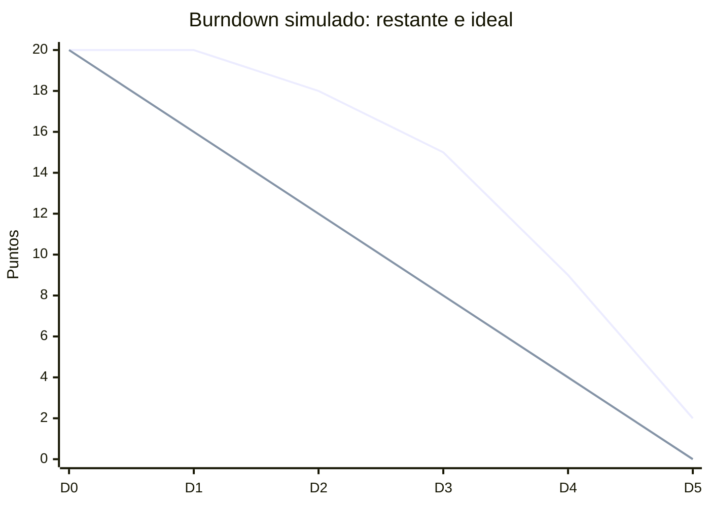
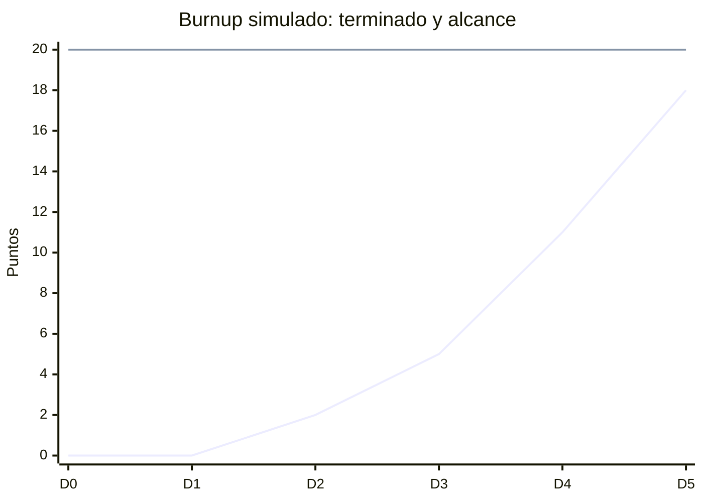

[Volver al README principal](../../README.md)

> **Actualización documental r3 — 17/11/2026.** El [estado técnico vigente](../ESTADO_TECNICO_VIGENTE.md) contiene la medición frontend nueva y sus límites. El texto r2 que sigue se conserva como registro histórico; sus pruebas backend, SW, análisis de seguridad y aceptaciones no se reejecutaron en r3. No constituye cierre aprobado.

# Radiadores de Información (Information Radiators)

## Complementación r4: radiadores simulados del trabajo de cierre

Se crean series ilustrativas para R4-01…R4-08 (20 puntos) del complemento común. No reconstruyen Sprint 1/2, no son capturas de Jira ni tareas ya aceptadas.

### Burndown y burnup del ejercicio

Tabla accesible: restante 20/20/18/15/9/2; ideal 20/16/12/8/4/0; terminado 0/0/2/5/11/18; alcance 20 en los seis cortes. Se supone finalización de 18/20 puntos (90 %) y 7/8 tareas (87,5 %). Queda R4-08 (guía/demostración) en revisión; no se calcula velocidad histórica del equipo con este ejercicio único.

### Tablero propuesto en D3

| Por hacer | En curso | Revisión/QA | Terminadas |
|---|---|---|---|
| R4-07, R4-08 | R4-05, R4-06 | R4-03, R4-04 | R4-01, R4-02 |

### Mood ilustrativo por roles ficticios

| Rol ficticio, sin respuestas de integrantes | Iteración 1 | Iteración 2 | Iteración 3 | Iteración final |
|---|---:|---:|---:|---:|
| PM del ejemplo | 3 | 3 | 4 | 4 |
| Backend del ejemplo | 3 | 2 | 3 | 4 |
| Frontend del ejemplo | 3 | 3 | 4 | 4 |
| QA/DevOps del ejemplo | 2 | 2 | 3 | 4 |
| Promedio ilustrativo | 2,75 | 2,50 | 3,50 | 4,00 |

Escala 1–5 definida en el complemento. La menor valoración de la iteración 2 es una hipótesis de carga por integración; no mide clima laboral real. Para aplicarlo se propone encuesta voluntaria, fecha y respuestas agregadas sin atribución personal.

### Retrospectiva propuesta

Mantener: dataset repetible y regresiones por criterio. Mejorar: preparar entorno temprano y reducir cola en revisión. Acciones: QA consolida matriz al 20/11; DevOps prepara entorno al 23/11; PM coordina revisión al 27/11/2026. Son propuestas con responsables por rol, no acuerdos de una reunión celebrada.
<!-- complemento-r4:fin -->

---

**Proyecto:** EcoLogística Junín / Huancayo. **Marco Ágil Utilizado:** Scrum dentro del enfoque híbrido documentado. **Versión:** 1.0.0.

## 1. Burndown Chart (Trabajo Restante)

**Burndown Chart:** no disponible en los registros revisados. No se localizó captura/serie diaria real de trabajo restante e ideal con compromiso inicial/cambios.

**Análisis de velocidad y tasa de finalización:** no calculable como serie. Las actas registran 20 SP comprometidos/0 Done en Sprint 1 y34 SP/0 Done en Sprint 2 en sus cortes; no son una velocidad actual ni permiten dibujar una línea diaria. No convertir tests/commits/porcentaje técnico a SP aceptados ni interpolar historia.

## 2. Burnup Chart (Trabajo Completado y Cambios de Alcance)

**Burnup Chart:** no disponible; faltan series de alcance total/completado aceptado y fechas de cambios aprobados.

**Análisis de crecimiento de alcance vs. trabajo aceptado:** no verificable. El backlog existe como catálogo y hay código parcial; no hay historial conciliado que permita cuantificar aumentos/reducciones ni aceptación acumulada. Obtener fuente auténtica y registrar desde ahora, sin retroproyectar datos.

## 3. Task Board / Tablero Kanban

**Análisis de flujo y cuellos de botella identificados:** la imagen muestra To Do/In Progress/In Review/QA/Done y tarjetas. No se dispone de fecha de captura/exportación actual ni tiempos de permanencia que permitan medir cuellos de botella. Los archivos relacionados de roadmap/planning/releases muestran 2024, frente a documentación 2026. Su presencia no prueba estado Done contra DoD actual. No se modifica la captura para que parezca reciente.

## 4. Mood Chart (Estado de Ánimo del Equipo)

| Integrante / Rol | Sprint 1 | Sprint 2 | Sprint 3 | Sprint Final |
|---|---|---|---|---|
| PM — respuestas individuales no registradas | No disponible | No disponible | No disponible | No disponible |
| Equipo técnico — respuestas individuales no registradas | No disponible | No disponible | No disponible | No disponible |

**Interpretación del clima laboral:** no disponible en los registros revisados; no hay escala, participantes/respondientes ni respuestas fechadas. Las filas identifican roles a consultar, no dos personas encuestadas. Retrospectivas optimistas o suites aprobadas no miden ánimo. Una encuesta actual no reconstruye el ánimo histórico de otros sprints.

## 5. Tableros de Retrospectiva

**Evidencia:** no se localizó imagen de un tablero real ni acta/participación de reunión de cierre. Existen retrospectivas textuales de Sprint 1/2/3; Sprint 2 se identifica como borrador técnico y Sprint 1 contiene propuestas no aprobadas. No sustituyen captura y ceremonia reales.

- **Lo que funcionó bien:** PostGIS descartable permitió regresiones de seguridad, integridad y suites completas; hay pruebas previas rojas y posteriores verdes conservadas. Es observación técnica, no resultado votado en retrospectiva.
- **Oportunidades de mejora:** alinear afirmaciones de Done, resultados originales, cobertura y contratos de prueba; registrar cambios, ánimo y aceptación oportunamente.
- **Acciones implementadas:** AF-01/02/03/24 corregidos con pruebas; estas son respuestas de ingeniería del ciclo autorizado, no acuerdos de una ceremonia histórica. No se acredita reunión/compromisos de equipo.

Faltan burndown/burnup/Mood/retro auténticos y un Kanban vigente para satisfacer completamente la rúbrica. No se fabricaron capturas, entrevistas ni series.
